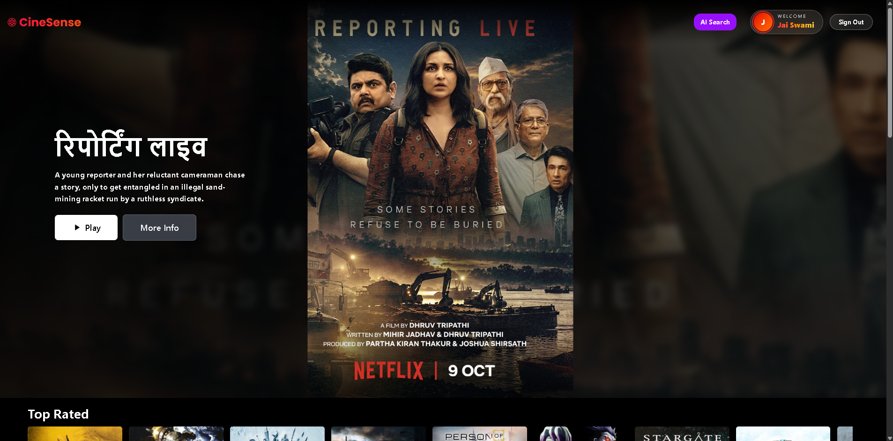
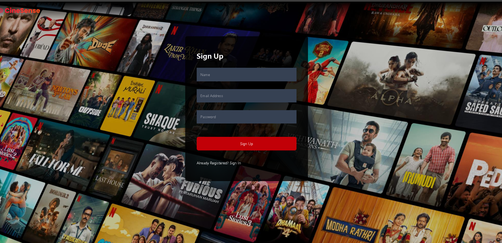
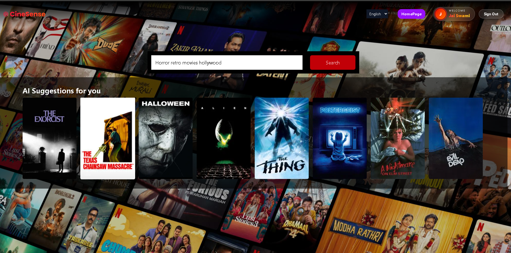
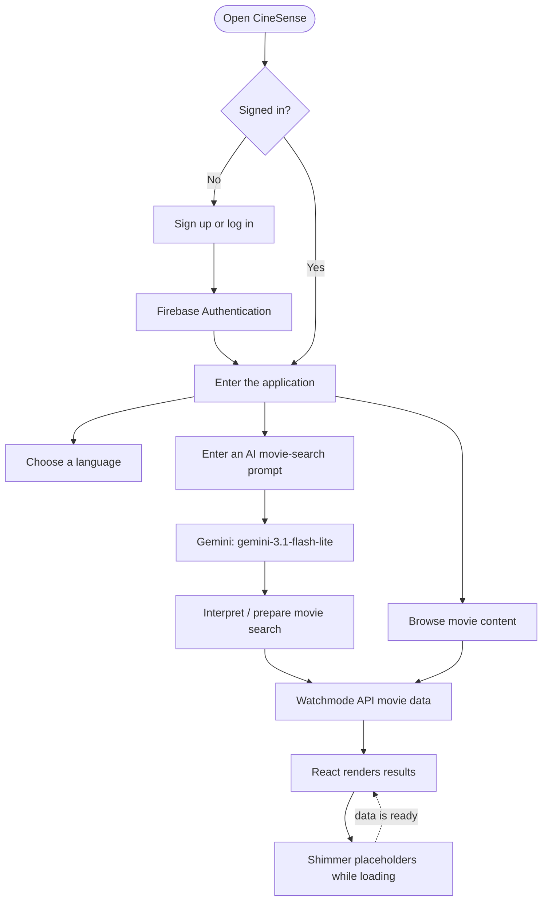
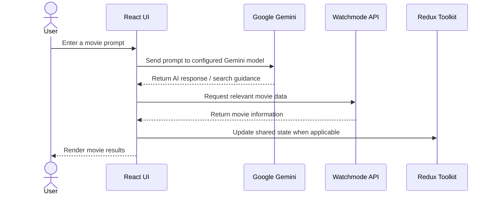
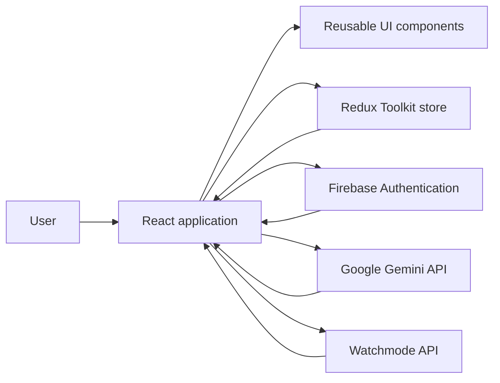
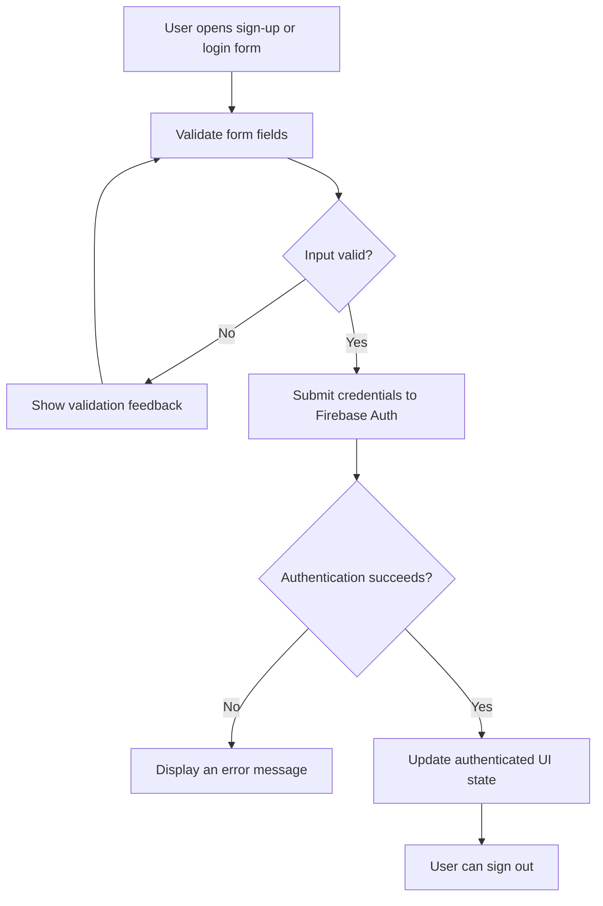

# 🎬 CineSense

### Discover your next favourite movie with AI.

A React-powered movie discovery experience that combines Gemini-powered natural-language movie search with movie data from Watchmode, Firebase authentication, multilingual UI, and a polished responsive interface.

[](https://cinesenseai-ac8ad.web.app/)
[](https://react.dev/)
[](https://firebase.google.com/)
[](https://tailwindcss.com/)

</div>

---

## 📌 Table of Contents

- [Overview](#-overview)
- [Features](#-features)
- [Screenshots](#-screenshots)
- [How It Works](#-how-it-works)
- [Architecture](#-architecture)
- [Technology Stack](#️-technology-stack)
- [Getting Started](#-getting-started)
- [Environment Variables](#-environment-variables)
- [Project Structure](#-project-structure)
- [Key Concepts Demonstrated](#-key-concepts-demonstrated)
- [Security Notes](#-security-notes)
- [Future Improvements](#-future-improvements)
- [Author](#-author)

## 🎥 Overview

**CineSense** is a movie discovery web application designed to make finding something to watch easier and more engaging. Users can create an account, browse movie information, and use an AI-powered search experience to discover titles from natural-language prompts.

Rather than relying only on a conventional title search, CineSense connects a React interface to **Google Gemini** for interpreting movie-search prompts and the **Watchmode API** for movie-related data. Firebase Authentication supports account flows, Redux Toolkit helps manage shared application state, and language support makes the interface more accessible.

> **Live application:** [cinesenseai-ac8ad.web.app](https://cinesenseai-ac8ad.web.app/)  
> **Source code:** [github.com/Karan3304/CineSense](https://github.com/Karan3304/CineSense)

## ✨ Features

### 🔐 Authentication
- Sign up, log in, and sign out.
- Firebase Authentication integration.
- Form handling and input validation for authentication flows.
- Auth-aware application experience.

### 🤖 AI-Powered Movie Search
- Search for movies using natural-language prompts.
- Uses Google's Gemini model configured as `gemini-3.1-flash-lite`.
- Helps translate a user's prompt into a movie discovery/search experience.
- Combines AI-assisted search with movie data retrieved from Watchmode.

### 🎞️ Movie Discovery
- Retrieve movie information using the Watchmode API.
- Explore movie titles and related details through a dedicated interface.
- Keep API-driven movie data separate from presentation components.

### 🌍 Multi-Language Support
- Language selection for supported interface text.
- Centralized language constants make translations easier to maintain.
- Redux Toolkit stores the selected language so relevant UI can respond to changes.

### ⚡ Responsive UI and Loading Experience
- Tailwind CSS utilities for responsive layouts and consistent styling.
- Shimmer-style loading placeholders while content is being fetched.
- Clear loading and content states help reduce the feeling of waiting.
- Reusable React components support a more maintainable interface.

### 🧠 State and Performance
- Redux Toolkit for shared application state.
- React hooks such as `useState`, `useEffect`, and `useRef`.
- Memoization concepts to avoid unnecessary repeated work where appropriate.
- Environment configuration for API credentials.

## 🖼️ Screenshots

Add screenshots from your own running application to make the repository easier to evaluate. Create a `screenshots/` folder and update the image paths below to match your files.

<!-- Suggested files: screenshots/home.png, screenshots/login.png, screenshots/ai-search.png -->
| Movie discovery | Authentication | AI movie search |
|---|---|---|
|  |  |  |

> If you have not added screenshots yet, upload them to `screenshots/` or replace this section with a short demo GIF. GitHub will show broken image placeholders until the referenced files exist.

## 🔄 How It Works

This flow illustrates the main user journey at a high level. The exact path can vary by screen and application state.



### AI search request flow



The diagram represents the intended integration at a conceptual level; it is not a claim that every search necessarily calls both services in this exact order.

## 🏗️ Architecture

CineSense uses a component-based React frontend. External services provide authentication, AI capabilities, and movie information, while Redux Toolkit coordinates shared client-side state.



### Authentication flow



## 🛠️ Technology Stack

| Technology | Role in the project |
|---|---|
| **React 19** | Component-based user interface |
| **React Router** | Client-side navigation |
| **Tailwind CSS 4** | Responsive styling and UI composition |
| **Redux Toolkit** | Shared state management |
| **React Redux** | Connecting React components to the store |
| **Firebase Authentication** | Sign-up, login, and sign-out flows |
| **Google GenAI SDK** | Integration with Gemini for AI-powered movie search |
| **Gemini `gemini-3.1-flash-lite`** | Configured model for interpreting movie-search prompts |
| **Watchmode API** | Movie catalogue and related movie data |
| **React Icons** | Icons in the interface |
| **Create React App / `react-scripts`** | Development server and production build tooling |

## 🚀 Getting Started

### Prerequisites

- [Node.js and npm](https://nodejs.org/)
- A Google AI API key for Gemini
- A Watchmode API key
- A Firebase project with Authentication configured

### 1. Clone the repository

```bash
git clone https://github.com/Karan3304/CineSense.git
cd CineSense
```

### 2. Install dependencies

```bash
npm install
```

### 3. Configure environment variables

Create a local `.env` file in the project root. Use the **exact variable names referenced in your source code**. The names below are illustrative; adjust them if your code uses different names.

```env
REACT_APP_GEMINI_API_KEY=your_gemini_api_key
REACT_APP_WATCHMODE_API_KEY=your_watchmode_api_key
```

If your Firebase configuration is read from environment variables, add the corresponding Firebase variables too, using the names expected by your Firebase initialization file.

**Important:** Never commit real credentials. Ensure `.env` is ignored by Git and only commit a sanitized `.env.example` if you want to document the required variable names.

### 4. Start the development server

```bash
npm start
```

The app should open at [http://localhost:3000](http://localhost:3000).

### 5. Create a production build

```bash
npm run build
```

The optimized production output is generated in the `build/` directory.

## 🔑 Environment Variables

| Variable | Purpose |
|---|---|
| `REACT_APP_GEMINI_API_KEY` | Example name for the Gemini API key; match it to your code |
| `REACT_APP_WATCHMODE_API_KEY` | Example name for the Watchmode API key; match it to your code |
| Firebase configuration values | Required only if your Firebase setup reads them from environment variables |

Create `.env` locally and configure equivalent values in your hosting provider's environment settings when needed. In a Create React App frontend, variables prefixed with `REACT_APP_` are embedded into the client bundle and **are not secret from users**. Environment files help keep credentials out of source control, but do not make browser-side API keys private. Use provider restrictions, quotas, and a trusted backend/proxy for sensitive keys where appropriate.

## 📂 Project Structure

The structure below is a **high-level guide**, not a verified, exhaustive directory listing. Adapt it to the actual files in `src/` as the project evolves.

```text

CineSense/
├── .firebase/                 # Firebase local/deployment configuration
├── .github/                   # GitHub-related configuration/workflows
├── build/                     # Production build output
├── public/
│   ├── favicon.ico
│   ├── index.html
│   ├── logo192.png
│   ├── logo512.png
│   ├── manifest.json
│   └── robots.txt
├── src/
│   ├── assets/                 # Static assets
│   ├── components/             # Reusable UI components
│   ├── hooks/                  # Custom React hooks
│   ├── utils/
│   ├── App.js

```

## 🧩 Key Concepts Demonstrated

- **Authentication and protected UI:** handling sign-up, login, sign-out, and authentication state.
- **Form handling and validation:** collecting user input and showing useful validation feedback.
- **API integration:** coordinating external AI and movie-data services.
- **Redux Toolkit:** organizing shared state and keeping components synchronized.
- **React hooks:** managing state and side effects with `useState` and `useEffect`, and accessing DOM/input values with `useRef` where appropriate.
- **Memoization:** understanding when caching a computed value or callback can reduce repeated work.
- **Internationalization:** separating translated UI strings from components and updating the selected language.
- **Loading states:** using shimmer placeholders while remote data is loading.
- **Responsive UI development:** building layouts with Tailwind CSS utilities.
- **Environment configuration:** keeping local configuration out of committed source files and configuring deployment variables.

## 🔒 Security Notes

- Do not commit `.env` files, private credentials, or service account keys.
- Client-side environment variables are visible to users after the app is built; do not treat a React frontend as a secure vault for API keys.
- Restrict API keys by API, domain/referrer, and quota when the provider supports it.
- If a key must remain confidential, route requests through a trusted server-side component.
- Validate input and handle authentication/API errors gracefully.
- Never publish real user credentials or authentication tokens in screenshots, logs, or issues.

## 🗺️ Future Improvements

Potential enhancements for future iterations:

- Add automated tests for authentication, validation, and AI-search flows.
- Add stronger API error handling, retry states, and empty-result messaging.
- Improve accessibility with keyboard navigation and screen-reader labels.
- Add search history or a personal watchlist if persistence is supported.
- Add a backend proxy for API requests that require private credentials.
- Include real application screenshots and a short demo GIF.
- Document exact environment variable names and the current source tree.

## 👨‍💻 Author

**Karan**

- GitHub: [@Karan3304](https://github.com/Karan3304)
- Project: [CineSense](https://github.com/Karan3304/CineSense)
- Live Demo: [CineSense on Firebase](https://cinesenseai-ac8ad.web.app/)

---

<div align="center">

**Built to explore the intersection of React, AI-powered search, and movie discovery.**

If you find the project useful, consider giving the repository a ⭐.

</div>


